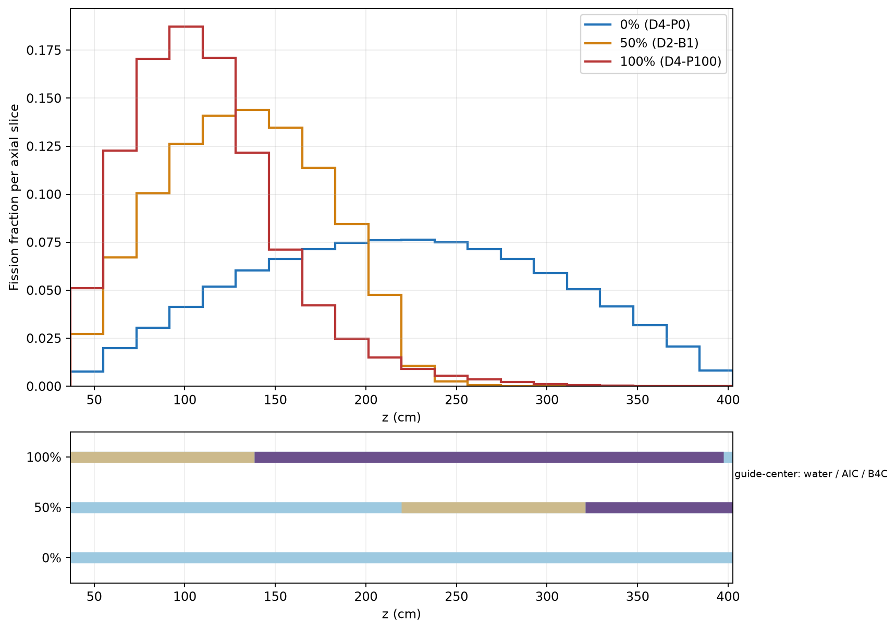
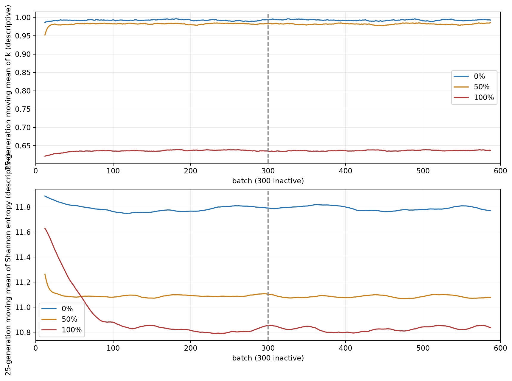

# D4 kayıt incelemesi — 2026-10-18

Bu inceleme yalnız kayıtlı `summary.json`, `resolved_config.json` ve küçük `fields.npz` dosyalarını okur. D2/D3/D4 koşuları, manifestleri ve büyük statepoint dosyaları değişmedi. Model MIT-CRPG BEAVRS şartname 3.0.2 / commit `1ccae04dc3830a5977f08ed7f5f7e1e51ded0d22` kaynaklı *idealize yalıtılmış demettir*. Ölçülmüş tam çekirdek doğrulaması değildir. Kaynak ölçüler ve çubuk yönü [reference_3d_model.md](reference_3d_model.md); uygulama [beavrs3d.py](../src/reactor_pipeline/beavrs3d.py) `build_model`, `_pin_universes`, `volume_fractions`.

Üç kayıt aynı kaynak config SHA256 `834a783ce2ac14cebdc1579e87bd731f0899251e3113c28d46cec42b52c223a6`, model kimliği, 975 ppm elementel bor, 0.740582068 g/cm³ su, 566.483 K malzemeler, 17×17 yakıt/kılavuz dizilimi, X/Y reflective ve z uçları vacuum sınırları, `fissionable` kısıtlı aktif-yükseklik kutu kaynağı ve aynı 17×17×20 tracklength `fission/kappa-fission/flux` tally tanımını kullanır. Hepsinde 600 toplam, 300 inactive, 20.000 parçacık/nesil, 1 nesil/batch ve 6 thread vardır. Tohumlar sırasıyla %0 için 45001, %50 (D2-B1) için 31001, %100 için 45101. D2-B1 ile D4'ün birleşik `pipeline_code_sha256` değerleri farklıdır; bu hash `beavrs3d.py` ile `experiments.py` dosyalarının birleşimidir ve yalnız hash'ten fizik kodunun değiştiği söylenemez. Kayıtlı referans config ve kaynak malzeme tanımı eşittir. Tek fark olarak tasarlanan fiziksel kontrol giriş oranıdır; hesap koşu kimliği/tohum ayrıdır.

Aktif yakıt tüm 264 yakıt pimi boyunca z=36.748–402.508 cm'dir; kaynak ve tally de bu aralıkta, 20 eşit z diliminde (18.288 cm) tanımlıdır. Aşağıdaki malzemeler yalnız **kılavuz eksenindeki** absorber bölgesini anlatır; rod kılıfı/He/su/Zircaloy eşmerkezli halkaları ayrıca vardır. Modelde alt uç `z_tip=402.508-(p/100)×365.76`; Ag-In-Cd (AIC) alt uçtan 101.60 cm, B4C onun üstünden 259.08 cm uzanır ve aktif vakum sınırında kesilir.

| Giriş | Kılavuz ekseninde aktif aralık, cm | Uç / AIC üstü / B4C üstü, cm | k ± MC standart hata | Alt 5 dilimin fisyon payı |
|---|---|---|---|---:|
| %0 | su 36.748–402.508 | 402.508 / 504.108 / 763.188 | 0.9922543 ± 0.0003440 | %15.135 |
| %50 | su 36.748–219.628; AIC 219.628–321.228; B4C 321.228–402.508 | 219.628 / 321.228 / 580.308 | 0.9821572 ± 0.0003535 | %46.193 |
| %100 | AIC 36.748–138.348; B4C 138.348–397.428; su 397.428–402.508 | 36.748 / 138.348 / 397.428 | 0.6366697 ± 0.0002855 | %70.268 |

%100'de 20. dilimin son 5.08 cm'si kılavuz merkezinde sudur. `volume_fractions` bu dilimi ne bütünüyle B4C ne de bütünüyle su sayar. %50 AIC/B4C sınırı z=321.228 cm de bir z dilimini keser. Kayıtlı `aic_volume_fraction`, `b4c_volume_fraction` ve `z_edges_cm` bu yerleşimle uyumludur; test ayrıca kılavuz, yakıt ve üst dilim noktalarını denetler.

Kaynak şartnamesinin *adım ölçeğinde* sıfır adım/tam sokulu geometrisi AIC altı 41.828 cm, AIC/B4C sınırı 143.428 cm, B4C üstü 402.508 cm'dir. V1'in %100 aktif-yükseklik tanımı bunların her birinden **5.08 cm aşağıdadır**. Bu, önceki modelleme kararındaki yüzde dönüşümünden gelir; %100'ü kaynak adım 0 ile özdeş görmek yanlış olur. D=213 adım dönüşümü bu modelde yoktur. Fark kayıtlı bir uygulama hatası kanıtı değildir, ama kaynak adım konumuyla doğrulama için ayrı model kararı gerektirir.

%100'de B4C üst bölgede, AIC alt bölgede bulunur. Üstteki daha güçlü soğurucu etkisi alt yakıt bölgesine göçü açıklayabilir; %0 simetrik eğri ve %50'nin alttaki su bölgesine kayışı yön olarak bunu destekler. Buna rağmen yalnız bu üç farklı fiziksel durumdan absorpsiyon, eksenel sızıntı ve kaynak dağılımının katkıları nicel olarak ayrıştırılamaz. Kayıtlar çubuk yönü, uç hesabı, kaynak/tally aralığı veya [z,y,x] dönüşümünde somut hata göstermiyor. Geometri dışı tanımsız bölge/çakışma denetimi örneklenmiş noktalara dayanır; bütün uzayın matematiksel ispatı değildir.

Üst beş dilimin fisyon payı %0/%50/%100 için sırasıyla %15.234 / %0.00129 / %0.1196'dır. %50 koşusunda 5.280 yakıt-kesişen voxelin 855'inde sıfır kappa-fission ölçülmüştür; %0 ve %100'de sıfır yoktur. %50'de kappa-fission yerel MC bağıl hatası ≤%20 olan 3.395 voxel toplam sinyalin %99.9737'sini; %100'de 4.095 voxel %99.9126'sını taşır. Bu **toplam katkı kapsamasıdır**, tüm voxel alanının güvenilirliği değildir. Çok düşük sinyalli üst bölge için bağıl hata veya tek sıfır ölçüm fiziksel sıfır diye yorumlanamaz. Tüm yakıt maskesinde `Σ σ_i / Σ μ_i` betimleyici büyüklüğü %0/%50/%100 için %1.958 / %1.475 / %1.758'dir; voxel korelasyonlarını içeren normalize alan belirsizliği değildir.

25 nesillik hareketli ortalama yalnız görsel amaçlıdır; özgün 600 değer `fields.npz` içinde kalır. İlk 50 ile inactive son 50 entropi ortalaması %0 için 11.858→11.805, %50 için 11.177→11.096, %100 için 11.466→10.817'dir. Aktif ilk 100 / son 100 k ortalamaları sırasıyla %0: 0.99354/0.99208, %50: 0.98231/0.98248, %100: 0.63590/0.63714. Aktif entropide aynı pencereler %0: 11.8054/11.7891, %50: 11.0838/11.0870, %100: 10.8269/10.8399. Bu farklar pencereler arası korelasyon bilinmeden z-testine çevrilmez. Eğrinin görsel platosu kaynak yakınsamasının kanıtı değildir; son 300 aktif batch tek tohumdur ve %100 için bağımsız tekrar yoktur. `completed` sadece çıktı bütünlüğüdür, fiziksel veya istatistiksel kabul değildir.

**Hedefli ek koşu kararı:** Yerleşimi ve alt-yığılmanın olası fiziksel mekanizmasını anlamak için şu anda yeni MC gerekmiyor; bu nedenle ilave manifest/notebook hazırlanmadı. %100 alanı eğitim verisi olarak kabul etmek istenirse önceden tanımlı yakınsama ve sabit-geometri alan ölçütleriyle bağımsız tohum veya daha yüksek bütçe ayrı onaylanmalıdır.
