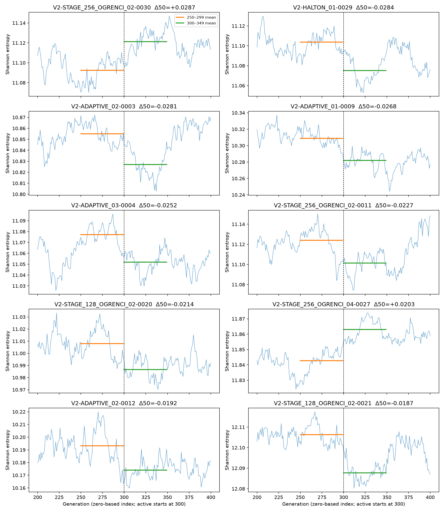

# 300 inaktif nesil sınırında entropi tanısı — v1

**PROVISIONAL_EXPLORATORY.** Bu ölçüler kaynak yakınsaması veya fiziksel kabul kararı değildir. Yeni MC veya model eğitimi yapılmadı.

Önceki takip analizindeki 0–99/200–299 ve 300–399/500–599 ortalamaları yeniden hesaplanmadı. Yalnız sınır çevresindeki 250–299 ve 300–349 ellişer neslin ortalama farkı, inaktif son 50 eğimi ve aktif 400–599 dalgalanması eklendi. Nesiller korelasyonlu olduğu için bu fark için bağımsız-örneklem anlamlılık testi yapılmadı.

512 senaryoda |sınır farkı| medyanı 0.00264, P90 0.00884, P95 0.01153, en büyük 0.02870. Bunlar eşik değil, dağılım betimlemesidir.

## En belirgin 10 sınır değişimi

| Deney | Giriş % | 250–299 → 300–349 entropi farkı | Son 50 inaktif eğim/nesil |
|---|---:|---:|---:|
| V2-STAGE_256_OGRENCI_02-0030 | 97.98 | +0.02870 | +0.000666 |
| V2-HALTON_01-0029 | 99.37 | -0.02838 | +0.000176 |
| V2-ADAPTIVE_02-0003 | 95.73 | -0.02807 | -0.000511 |
| V2-ADAPTIVE_01-0009 | 93.96 | -0.02684 | -0.000483 |
| V2-ADAPTIVE_03-0004 | 96.62 | -0.02524 | -0.000093 |
| V2-STAGE_256_OGRENCI_02-0011 | 97.70 | -0.02273 | -0.000764 |
| V2-STAGE_128_OGRENCI_02-0020 | 96.32 | -0.02136 | -0.000324 |
| V2-STAGE_256_OGRENCI_04-0027 | 19.86 | +0.02031 | +0.000399 |
| V2-ADAPTIVE_02-0012 | 93.49 | -0.01916 | -0.000398 |
| V2-STAGE_128_OGRENCI_02-0021 | 1.58 | -0.01865 | -0.000182 |

Sıralama yalnız sınırdaki mutlak 50 nesillik ortalama değişimine göredir; grafikte 200–400 aralığı gösterilir. Farkın büyüklüğü entropi meshine ve MC dalgalanmasına bağlıdır. Tek global Shannon entropisi uzaysal kaynak dağılımının bütün biçimlerini ayırt edemez. Kaynak yakınsaması için ayrıca k geçmişi, uzaysal kaynak göstergeleri ve gerekçeli değerlendirme kuralı gerekir. 512/512 için `source_convergence_status=NOT_ASSESSED` korunur.

Kaynaklar: `datasets/v2_512_combined_v1/fields.npz` ve önceki `reports/physical_acceptance_followup_v1/scenario_evidence.csv`. OpenMC kaynak entropisi açıklaması: https://docs.openmc.org/en/stable/methods/eigenvalue.html
