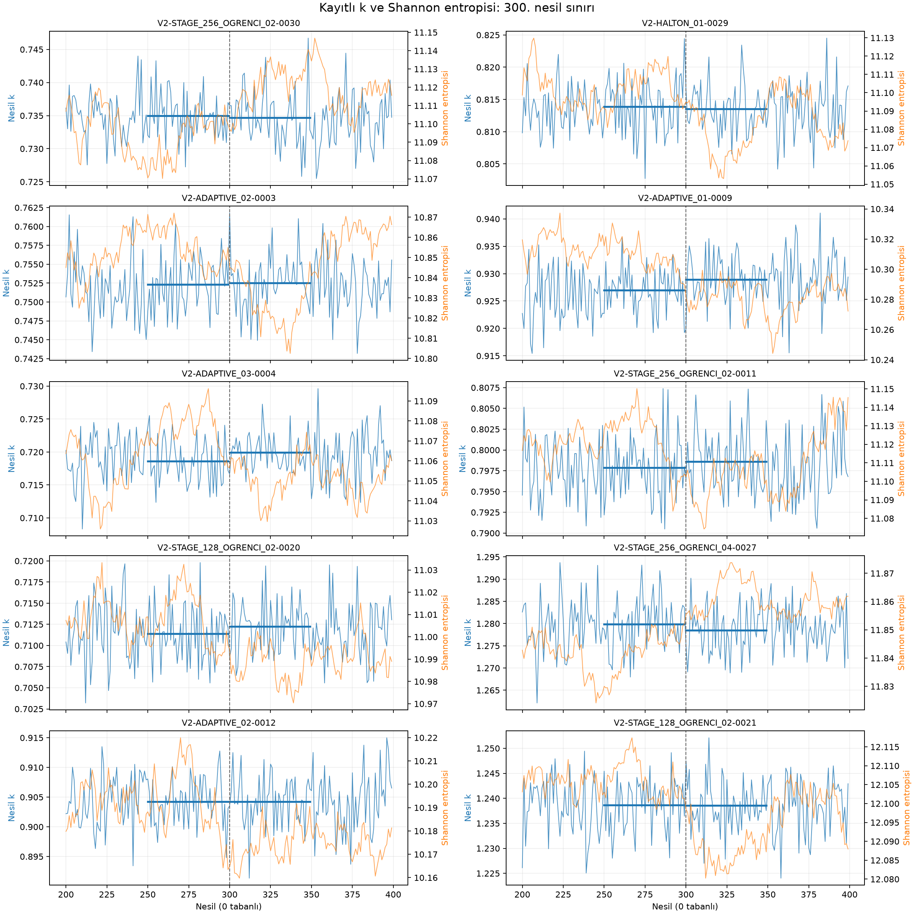

# Entropi sınırında k geçmişi — ilk 10 senaryo

Kaynak: önceki `entropy_boundary_diagnostics.csv` dosyasında en büyük mutlak entropi değişimine sahip 10 senaryo; `v2_512_combined_v1/fields.npz` içindeki kayıtlı nesil geçmişleri. Nesiller **0 tabanlıdır**. Yeni transport hesabı yapılmadı.

| Senaryo | k 250–299 | k 300–349 | Δk | Δentropi |
|---|---:|---:|---:|---:|
| V2-STAGE_256_OGRENCI_02-0030 | 0.734972 | 0.734693 | -0.000279 | +0.02870 |
| V2-HALTON_01-0029 | 0.813897 | 0.813520 | -0.000377 | -0.02838 |
| V2-ADAPTIVE_02-0003 | 0.752307 | 0.752522 | +0.000216 | -0.02807 |
| V2-ADAPTIVE_01-0009 | 0.926965 | 0.928941 | +0.001976 | -0.02684 |
| V2-ADAPTIVE_03-0004 | 0.718607 | 0.719936 | +0.001329 | -0.02524 |
| V2-STAGE_256_OGRENCI_02-0011 | 0.797886 | 0.798607 | +0.000721 | -0.02273 |
| V2-STAGE_128_OGRENCI_02-0020 | 0.711396 | 0.712255 | +0.000859 | -0.02136 |
| V2-STAGE_256_OGRENCI_04-0027 | 1.279848 | 1.278528 | -0.001320 | +0.02031 |
| V2-ADAPTIVE_02-0012 | 0.904247 | 0.904251 | +0.000004 | -0.01916 |
| V2-STAGE_128_OGRENCI_02-0021 | 1.238627 | 1.238608 | -0.000019 | -0.01865 |

Entropi ve k pencere ortalaması 2/10 senaryoda aynı yönde, 8/10 senaryoda ters yönde değişti. Mutlak Δk aralığı 0.000004–0.001976; en büyük mutlak Δk V2-ADAPTIVE_01-0009 koşusunda görüldü. Dolayısıyla büyük entropi değişimleri, k ortalamasında tek yönlü ve tutarlı bir değişimle eşleşmiyor. Nesil bazındaki dalgalanma ve ardışık nesillerin bağımlılığı nedeniyle bu karşılaştırma istatistiksel anlamlılık veya kaynak yakınsaması testi değildir.

Bu tanıdan otomatik fiziksel kabul veya ret kararı çıkarılmadı.
