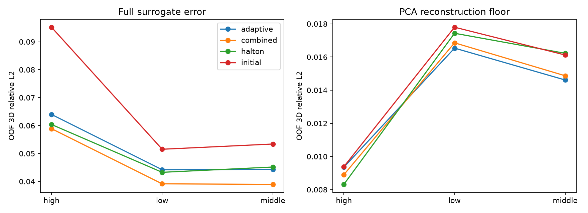
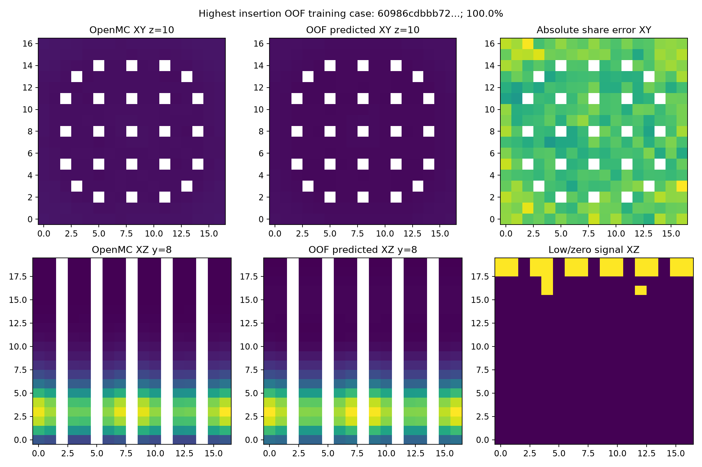
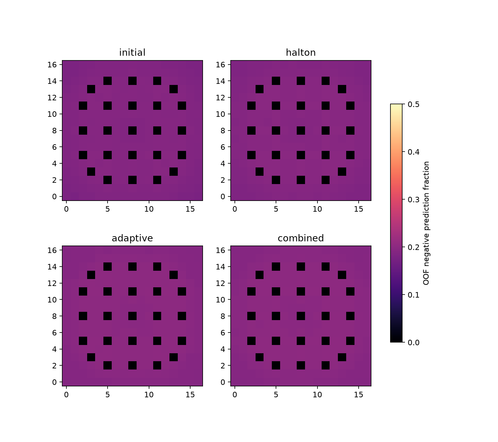

# Fiziksel hata analizi v1

**PROVISIONAL_EXPLORATORY.** Dondurulmuş XGBoost ve PCA12 ile eğitim içi 5-fold OOF tahminleri yeniden üretildi. Eski 23 test örneği model ayarında kullanılmadı.

## Yüksek kontrol çubuğu girişi

Birleşik OOF alan L2 düşük/orta/yüksek girişte 0.039144 / 0.038966 / 0.058903.
k mutlak hatası aynı bantlarda 0.006137 / 0.006003 / 0.014297. Yüksek bantta 163 eğitim örneği vardır. PCA yeniden oluşturma L2si 0.016856 / 0.014868 / 0.008904; yüksek girişte temsil daha kötü değildir.
Toplam hatanın yükselmesi, PCA katsayılarını sekiz girdiden öğrenme adımıyla ilişkili olabilir. Nedensel açıklama kanıtlanmadı. Yüksek bantta yakıt voxel sayısının %24.72si sıfır tally, %21.24ü düşük pozitif sinyaldir.

## Eksenel, radyal ve negatif tahminler

Birleşik OOF alanında 464 senaryonun 2,449,920 yakıt voxeli vardır. Alt/orta/üst eksenel bölgelerin gerçek normalize üretim payı 259.72 / 196.01 / 8.27 senaryo-pay; mutlak hata payı 9.18 / 10.46 / 2.49dur. Üstte üretim az olsa da hata orantısızdır.
Negatif ham tahmin sayısı altta 0, ortada 216,198, üstte 268,494tür. Giriş bantlarına göre negatif oranı düşük %4.00, orta %28.40, yüksek %24.83: monoton ilişki yoktur. Radyal ayrım regional_oof_errors.csv içindedir.

## MC istatistiği ile model hatası

Yakıt maskesinde 333101 sıfır ölçümlü, 377538 düşük pozitif sinyalli ve 1739281 güçlü sinyalli voxel vardır. Düşük sınıf: pozitif ham kappa < 5 x ham MC SE veya normalize pay < 10^-6 x senaryonun maksimum payı. Eşik tanı amaçlıdır.
Düşük pozitif sinyalde ham tally göreli MC SE medyan/P95: 0.529 / 1.000; güçlü sinyalde 0.0099 / 0.124. Sıfır tallyde SE=0 görünmesi sıfır fiziksel belirsizlik değildir. Normalize alan kovaryansı yoktur.
Toplam mutlak model pay hatasının yaklaşık %92.7si güçlü sinyalli voxel bölgelerinden gelir (20.52 / 22.13). Zayıf voxel bölgelerini filtrelemek toplam hatayı açıklamaz.

## Kol farkı ve parametre ilişkileri

OOF ortalama k hatası Halton 0.010611, adaptif 0.010375, birleşik 0.008957; alan L2 0.049780, 0.051131, 0.046024. Ortak 208 başlangıç senaryosunda birleşik modelin OOF k ve alan hatası Haltondan daha düşüktür. Eski, tekrar incelenmiş 23 testte ise Halton k MAE daha düşüktür. Bu ayrışma küçük test örneklemi veya farklı örnek dağılımıyla uyumludur; genel üstünlük kanıtı değildir.
Birleşik eğitim OOF Spearman rho: çubuk girişi ve k -0.534, çubuk girişi ve alan hatası +0.333, bor ve k -0.428, bor ve alan hatası -0.087. Yakıt/su sıcaklığı ile alan hatası mutlak rho<0.052. Sekiz girdi birlikte değiştiğinden bunlar bağımsız nedensel etkiler değildir.
Tüm senaryo, bölge ve parametre tabloları CSV olarak; örnek gerçek OpenMC / OOF XY-XZ kesitleri high_insertion_xy_xz.png olarak kayıtlıdır. Pitch değişimi yüzünden aynı indeks halkası her senaryoda aynı santimetre koordinatını temsil etmez.

