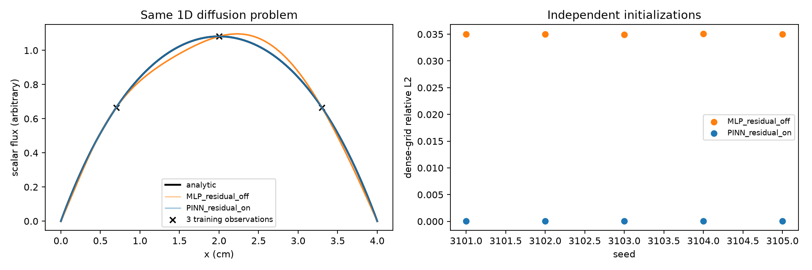
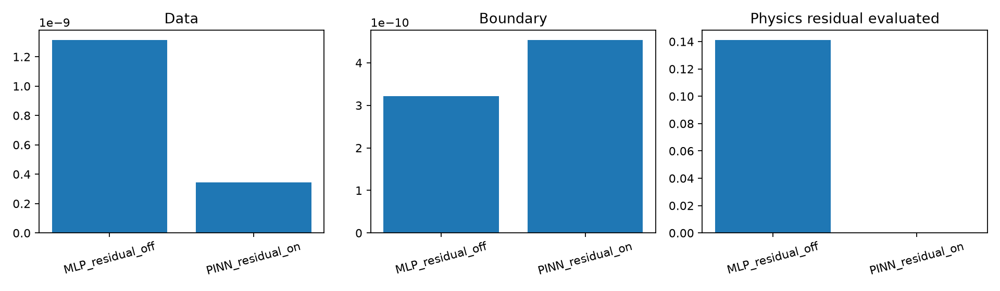
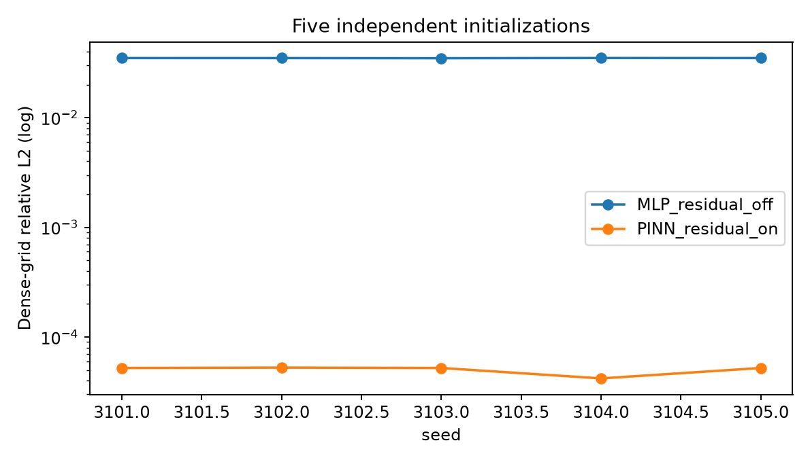

# Gerçek PINN fizibilitesi ve kontrollü 1B deney v2

**PROVISIONAL_EXPLORATORY.** Bu deney BEAVRS-türevi 3B model üzerinde yapılmadı ve nükleer güvenlik doğrulaması değildir. Önceki v1 aynı problemde 550 değerlendirme sınırına ulaştığı için saklandı; bu v2 iki yönteme eşit 1800 değerlendirme üst sınırı ve aynı gevşetilmiş sayısal durma ölçütünü uygular. Beş seedin iki yöntemi de optimizer_success=True ile bitti.

## Problem ve analitik referans

Homojen, tek enerji gruplu 1B sabit kaynak difüzyon problemi: -D phi ikinci türev + Sigma_a phi = Q, 0<=x<=L. D=1 cm, Sigma_a=0.5 /cm, Q=1 keyfi kaynak birimi, L=4 cm. phi(0)=phi(L)=0 matematiksel ekstrapole slab sınırıdır; 3B OpenMC vakum sınırının birebir temsili değildir. Analitik çözüm: phi(x)=(Q/Sigma_a)[1-cosh(k(x-L/2))/cosh(k L/2)], k=sqrt(Sigma_a/D). Aynı formül experiment_config.json içinde kayıtlıdır.

Üç iç gözlem x=0.7, 2.0, 3.3 cm; 64 iç kolokasyon noktası; bağımsız yoğun değerlendirme 401 noktadır. Aynı 16 tanh nöronlu ağ, aynı başlangıç seedleri 3101-3105 ve aynı scipy least_squares optimizeri kullanıldı.

## Kayıp ve ablation

Rezidüel -D phi ikinci türev + Sigma_a phi - Q analitik tanh türevinden hesaplanır. Toplam en-küçük-kare vektöründe veri uyumu, sınır koşulu ve denklem rezidüeli ayrı ölçeklenir; her üçünün ağırlığı 1dir. Ortak 1e-6 ağırlık cezası kullanılır. Klasik MLP, **aynı ağ ve optimizasyonla fizik rezidüeli ağırlığı tam 0 yapılan ablation** sürümüdür. PINN ağırlığı 1dir. Yalnız pozitiflik/normalizasyon uygulanmadı.

| Yöntem | Seed | Yoğun-grid bağıl L2 ort. ± SS | PDE rezidüeli RMS | Sınır max abs ort. | Süre ort. | Başarılı durma |
|---|---:|---:|---:|---:|---:|---:|
| MLP, rezidüel kapalı | 5 | 0.035005 ± 0.000051 | 0.410196 | 0.000027 | 1.30 s | 5/5 |
| Gerçek PINN | 5 | 0.000050 ± 0.000005 | 0.002512 | 0.000032 | 2.29 s | 5/5 |

Ölçekli veri kaybı ortalaması MLP 1.32e-9, PINN 3.45e-10; sınır kaybı sırasıyla 3.22e-10 ve 4.54e-10. Denklem rezidüeli kaybı MLP için yalnız değerlendirilir (0.141278), PINN eğitimine katılır (yaklaşık 0.000003). PINN bu **yalnız kontrollü denklemde** analitik çözüme daha yakın ve PDE rezidüeli daha küçüktür. Eğitim süresi daha uzundur.

## 17x17 BEAVRS-türevi modelle sınır

Mevcut 512 datasetinde sekiz fiziksel girdi, k, 20x17x17 toplam flux/fission/kappa-fission, ham MC standart hataları, geometri hacim kesirleri ve mesh koordinatları vardır. Eksen sırası [z,y,x]tir. Bu alanlar enerji ve açı üzerinden bütünleşik tallydir; enerji/açı çözümlü akı veya uzaysal/enerji gruplu taşınım operatörü değildir.

Gerçek taşınım PINNi için açısal/enerji çözümlü akı, toplam ve saçılma kesitleri, fisyon üretimi, kaynak ve sınır operatörü gerekir. Difüzyon PINNi için önceden seçilmiş enerji gruplarında doğrulanmış D, Sigma_a, saçılma matrisi, nuSigma_f ve fisyon spektrumu ile malzeme ara yüzü ve sınır ayrıklaştırması gerekir. Mevcut kaydedilmiş fission/kappa/flux tallyleri bu katsayıları doğrudan vermez. Nükleer HDF5 ve model.xml malzeme bilgisi kısmen mevcut olsa da flux-ağırlıklı, alan bazlı katsayılar yalnız isim ve bileşimden çıkarılamaz.

OpenMCnin [çok gruplu difüzyon katsayısı belgeleri](https://docs.openmc.org/en/latest/pythonapi/generated/openmc.mgxs.DiffusionCoefficient.html) bu katsayı için ayrı enerji grubu ve domain/tally gerektirir; [MGXS türleri](https://docs.openmc.org/en/stable/pythonapi/mgxs.html) saçılma ve fisyon terimlerini ayrı listeler. Mevcut 3B modelde x/y reflective, aktif z uçları vacuumdur; toy Dirichlet sınırıyla eşdeğer değildir.

Güvenilir veri tanımlı kısıtlar: yakıt geometrik maskesi, normalize kappa-fission payında negatif olmama ve toplamın 1 olması. Bunlar çıktı kısıtıdır, PDE rezidüeli değildir. Vakum sınırında skaler fluxu doğrudan sıfıra zorlamak veya bor/sıcaklık için evrensel monotonluk dayatmak bu veriyle gerekçelendirilmemiştir.

Daha gerçekçi 3B PINN öncesi: kullanım amacı (tam taşınım mı difüzyon mu), enerji grup yapısı, MGXS tallyleri, uzaysal malzeme katsayıları ve kovaryansları, ara yüz akım sürekliliği, fiziksel sınır eşlemesi, bağımsız doğrulama ve nükleer veri eşdeğerliği gerekir. Bunları üretmek yeni OpenMC işi veya ek kaynak veri gerektirebilir; bu görevde yapılmadı. Toy başarısı gerçek reaktör için başarı kanıtı değildir.

Analitik referans ayrıca bağımsız merkezli sonlu farkla kontrol edildi: sınır max abs 0; diferansiyel denklem rezidüeli max 3.89e-8 (h=1e-3 cm). Bu sayısal doğrulama toy problem için geçerlidir.

